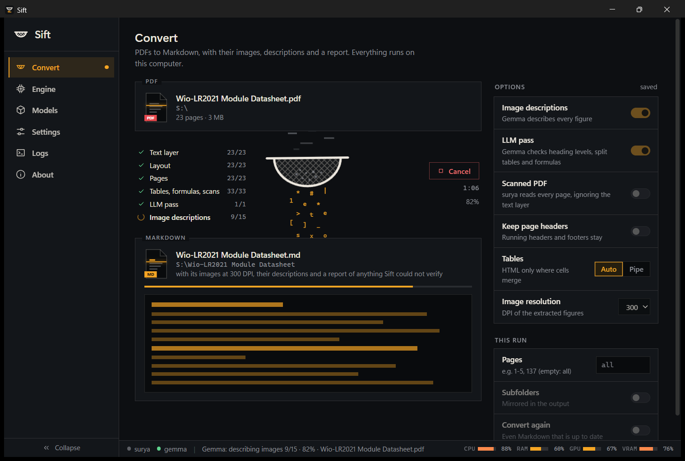

<picture>
  <source media="(prefers-color-scheme: dark)" srcset="docs/brand/banner-dark.svg">
  
</picture>

# Sift

**PDFs to Markdown you can trust: every value checked against the PDF itself, every image kept
and described, everything local.**

Sift turns a PDF (or a folder of PDFs) into clean Markdown with its images at 300 DPI, a
description of every figure, and a short report of anything it could not verify. It is built for
technical documents full of tables, register maps, formulas and diagrams, where a wrong number is
worse than a missing one.

It began as the simplest possible job: converting a PDF to Markdown so an AI can read it. marker
did that for a while, but grew heavy (Docker, a large Python stack, an online model for the best
results), so Sift started over from scratch: simple, accurate, fast and local.

Two models do the work, on your GPU, through official llama.cpp builds:
- **surya 2.5** reads what the PDF's text layer can't give: tables, formulas, scanned or broken
  text, labels inside images (its layout model finds the blocks on each page);
- **Gemma 4 E4B** describes the images, sets heading levels, joins tables split across pages,
  writes missing formulas and reviews the tables the checks couldn't verify.

> **Status: alpha (1.0.0-alpha.3), Windows only for now.** The core is plain Rust and the window
> is Tauri, but the engine manager installs Windows CUDA builds of llama.cpp and only Windows is
> tested. Linux and macOS are planned.

## Why Sift?

- **The PDF's own text is the ground truth.** Text comes from the PDF's text layer, exact and
  free. surya reads only what the text layer can't give, and every number or identifier it writes
  in a table is checked against the PDF's text there: found -> kept; one close PDF value ->
  replaced by the exact PDF value; otherwise kept and listed in the report.
- **Local only.** No account, no API key, no telemetry. The network is used only when you ask:
  installing or updating llama.cpp, downloading a model.
- **Your folders.** You choose where the llama.cpp engine and the models go; nothing is ever
  downloaded into a hidden app-data folder.
- **Measured.** Ahead of marker on all seven reference datasheets (errors per 1,000 PDF words on
  the 250-page LR20xx: 46.8 vs marker's 56.1), and every change is checked byte for byte against
  a golden set before it lands.

## Install

1. Download `Sift_<version>_x64-setup.exe` from the
   [Releases page](https://github.com/NairoDorian/Sift_PDF_to_MD/releases) (its `.sha256` sits
   next to it) and run it. It installs for your user only, no administrator rights needed.
2. Open Sift. The Setup page asks where llama.cpp and the models go (about 0.6 GB and 6.2 GB),
   then installs the newest official llama.cpp CUDA 13.5 build and downloads the three models.
   Nothing is downloaded before you choose the folders and press the buttons.
3. Drop a PDF (or a folder of PDFs) on the window and press **Convert**.

The installer also puts `sift.exe`, the command line, next to the window's program (the About
page shows the folder). You need Windows 10/11 x64 and an NVIDIA GPU whose driver supports CUDA
13.5 (8 GB is enough). In the released build the layout model runs on the CPU; the GPU layout
build is in [Build from source](#build-from-source).

## The window



The Convert page reads like the job itself: the PDF on top, the sieve under it (the pipeline's
stages on its left, Convert on its right), the Markdown at the bottom. While Sift works, the sieve
shakes and characters of Markdown pour out of its net into the document; when it is done the card
shows the file, its numbers (pages, tables, images described, table values fixed from the PDF)
and its first lines, with Open, Show in folder and Report.

| Page | What it holds |
|---|---|
| Setup | the first run: the two folders, llama.cpp, the models (shown until all is ready) |
| Convert | the PDF or folder, the run (pages, subfolders, convert again) and the saved options |
| Engine | official llama.cpp builds: check, install or update with progress, use, roll back, delete; the backend; the model servers |
| Models | the three pinned models: download with progress, verify (sha256), delete, check for new revisions |
| Settings | theme, motion, how the two models share the GPU, where everything is |
| Logs | this session's events, filterable, copyable |
| About | versions, the GPU, the command line, credits and licenses |

Every setting lives in one place: the conversion options on Convert (saved, and the command line
reads the same file), the engine's folder, backend and start-up check on Engine, the models'
folder on Models. Motion follows Windows' "Animation effects" unless Settings says otherwise.

## Requirements (building from source)

- Windows 10/11 x64; an NVIDIA GPU whose driver supports CUDA 13.5 (8 GB is enough).
- To build: [Rust](https://rustup.rs/) 1.99 or newer and [Bun](https://bun.sh/) 1.4 or newer.
- `pdfium.dll` from the official [pdfium-binaries](https://github.com/bblanchon/pdfium-binaries)
  build `chromium/7891` (`pdfium-win-x64`, file `bin/pdfium.dll`). Put it next to `sift.exe`, in
  `runtime/pdfium/` for development, or point `SIFT_PDFIUM` at it. The exact build matters: the
  golden test expects its characters and pixels.
- For the golden test and the scorers: [uv](https://docs.astral.sh/uv/) (the scripts use only
  Python's standard library) and bash (Git Bash on Windows).

## Quick start (command line)

```bash
cargo build --release -p sift-cli                        # target/release/sift.exe
sift setup --engine-dir D:\Sift\engine --models-dir D:\Sift\models
                                                          # newest official llama.cpp (CUDA 13.5) + the three models (6.2 GB)
sift convert datasheet.pdf -o out/                        # out/datasheet/datasheet.md + images/ + report
sift convert folder/ -o out/ --recursive                  # a whole folder, subfolders mirrored
sift engine check                                         # is there a newer official llama.cpp build?
sift engine update                                        # download, verify, switch (the previous build is kept)
sift models status                                        # the three models: installed, size, revision
```

Useful flags: `--pages 1-5,137`, `--no-llm` (descriptions only), `--describer off`, `--mode
full-ocr` (surya reads every page), `--tables markdown`, `--keep-headers`, `--json` (progress
events), `--profile`, `--answers <dir>` (keep every model answer: a re-run reuses them).
Settings: [docs/settings.md](docs/settings.md) (`sift config show`).

## Build from source

The window is Tauri 3 + SolidJS 2; the same binary runs the command line when given a subcommand
(`sift-app convert file.pdf`).

```bash
cd app
bun install
bun run tauri dev        # development: Vite dev server + the app, rebuilt on change
bun run dev              # the window alone in a browser (http://localhost:1430), with sample data:
                         #   ?demo=running|done|folder|setup, ?page=engine, ?theme=dark, ?motion=on
```

The installer (`target/release/bundle/nsis/Sift_<version>_x64-setup.exe`): put `pdfium.dll`,
`LICENSE` and `licenses/` from the pdfium-binaries `chromium/7891` archive in `runtime/pdfium/`,
then `cd app && bun x tauri build --config src-tauri/tauri.release.conf.json`. The
[Release workflow](.github/workflows/release.yml) does the same on GitHub and attaches the
installer to a draft release. The app's icons and the art in `docs/brand/` come from one geometry
(`app/src/lib/brand.ts`): `bun scripts/gen-icons.ts`.

Speed, cold, on an RTX 4070 Laptop (8 GB), with descriptions and the LLM pass: 250 pages in
355 s, 23 pages in 86 s.

## How it works

1. **Text layer** (pdfium + pdftext's algorithm): characters, fonts, positions, super- and
   subscripts, the document's own vocabulary (to tell "appli-cations" from "on-chip").
2. **Layout** (surya's rf-detr, in Rust, on the GPU or the CPU): paragraphs, headings, lists,
   tables, formulas, figures, page furniture, reading order.
3. **surya 2.5**: tables, formulas, broken or scanned text, labels inside raster figures.
4. **Checks**: table values against the PDF, merged cells, missing cell text put back, structure
   vs page geometry.
5. **Gemma 4 E4B**: figure descriptions with the figure's own text as context; heading levels;
   tables split across pages; formulas; a guarded review of tables Sift couldn't fully verify.
6. **Markdown**: pipe tables (HTML only for merged cells), images with their descriptions, and
   `<name>.sift-report.txt` listing what could not be resolved.

Step by step: [CURRENT_ARCHITECTURE.md](CURRENT_ARCHITECTURE.md). The plan:
[MASTER_PLAN.md](MASTER_PLAN.md). Contributing and the development routine:
[AGENTS.md](AGENTS.md). Reviewing the code: [docs/AUDIT.md](docs/AUDIT.md).

## Measuring quality

- `bash bench/golden/run.sh`: the golden test (7 datasheets, stored answers, byte-identical
  Markdown and reports; [docs/GOLDEN.md](docs/GOLDEN.md)). The reference PDFs are not in the
  repository; the doc lists them with their sha256.
- `bench/score.py` (scorecard v2) scores any number of outputs of one PDF against its text layer:
  PDF words and lines found, reading order kept, invented words, invented numbers, one
  errors-per-1,000-words figure, and grades from the run's own checks.

## Licenses

Sift's own code: Apache-2.0 ([LICENSE](LICENSE)). Ported code keeps its origin's terms
([NOTICE](NOTICE)): surya, marker, pdftext, rf-detr (Apache-2.0, Datalab / Roboflow), Pillow's
resampling (MIT-CMU), ZER0 / Handy (MIT). Model weights are downloaded from their own
repositories under their own licenses (surya 2.5 and its layout model: Datalab's modified
OpenRAIL-M; Gemma: Gemma terms); using Sift implies accepting them.
